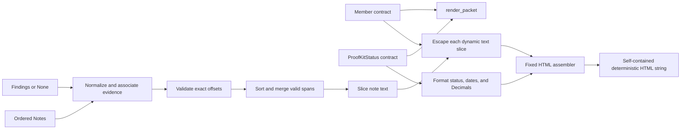

# Proof Packet Design Document

## Overview

The Proof Packet renderer will be implemented in `src/proofkit/integration/packet.py` as a deterministic, side-effect-free HTML serialization boundary:

```python
def render_packet(
    member: Member,
    status: ProofKitStatus,
    findings: Sequence[Finding] | None = None,
    notes: Sequence[ClinicalNote] = (),
) -> str:
    ...
```

It returns one self-contained HTML string and performs no file I/O, network access, clock reads, random generation, PDF conversion, or mutation. PDF conversion remains an optional downstream concern and is not part of this renderer's interface. The default `findings=None` is normalized to an empty sequence so `render_packet(member, status)` produces a valid packet.

The approved [requirements](./requirements.md) are the behavioral authority. Repository research also confirmed the following implementation constraints:

- The immutable Pydantic models and enums are publicly re-exported by [`proofkit.contracts`](../../../src/proofkit/contracts/__init__.py); the renderer can consume all required data without importing module internals.
- The FINAL ownership guide requires integration code to call only public module APIs and to escape note and document content ([`FINAL_INTEGRATION_UI.md`](../../../docs/roles/FINAL_INTEGRATION_UI.md)).
- Wallet output exposes `Decimal` values and raw earnings `source_quote` text through the contract models; its handoff explicitly requires escaping both source quotes and platforms ([wallet handoff](../../../src/proofkit/wallet/HANDOFF.md)).
- Reasoning output exposes plain-text statement drafts and review reasons that must be escaped ([reasoning handoff](../../../src/proofkit/reasoning/HANDOFF.md)).
- Hypothesis is already available as a pinned development dependency in [`pyproject.toml`](../../../pyproject.toml), so no custom generator framework or new dependency is needed.

No external research is needed: the approved requirements, frozen local contracts, and public handoffs completely define this renderer. The design does not add domain rules or reinterpret upstream results.

### Goals

- Render the required status, member identity, monthly compliance, evidence, clinician statement, deadlines, action items, and disclaimer in one document.
- Treat every dynamic string as text, even where a contract currently constrains its shape.
- Preserve original note offsets by slicing before escaping.
- Degrade safely for invalid evidence offsets and missing notes.
- make byte output reproducible for byte-equivalent ordered inputs.
- Keep wallet and reasoning implementation details outside the rendering boundary.

### Non-goals

- Recompute exemption or wallet decisions.
- Validate policy correctness or infer missing evidence.
- Modify frozen contracts.
- Generate PDFs, write files, fetch assets, or serve HTML.
- Sanitize by deleting user text; untrusted text remains visible but is HTML-escaped.

## Architecture

The renderer is a leaf component in the integration layer. Upstream orchestration supplies already-constructed contract models; the renderer only projects those values into a fixed HTML skeleton.



### Boundary decisions

1. **Contract-only input boundary.** `packet.py` imports model types and enums only from `proofkit.contracts`, plus Python standard-library facilities such as `html.escape`, `Decimal`, and `Sequence`. It does not import wallet or reasoning internals. It does not need to call wallet or reasoning at all; should a future call become necessary, it may only use those packages' public `__init__` exports.
2. **Fixed markup, dynamic text.** Doctype, element names, attributes, labels, CSS, status labels, and table structure are renderer-authored constants. Dynamic values are escaped into text nodes and are never interpolated into tag names, attribute names, CSS, raw markup, or URL-valued attributes.
3. **No active-content surface.** The skeleton contains no `<script>` element, no attribute whose name begins with `on`, and no URL-bearing `href`, `src`, `action`, or equivalent attribute. Consequently dynamic text cannot become an event handler or `javascript:` URL. The only security-policy attribute is the fixed CSP meta element.
4. **Exact CSP.** The `<head>` contains a fixed meta declaration whose content value is exactly `default-src 'none'; style-src 'unsafe-inline'; img-src data:`. Styles are in one renderer-authored `<style>` element; there are no external stylesheets, scripts, fonts, or other dependencies.
5. **Ordered deterministic assembly.** HTML is accumulated in a list of fragments and joined with `"".join`. The document has a fixed section order and fixed `\n` characters rather than platform-dependent line separators. There is no templating engine, clock, locale, random identifier, hash-order traversal, or generated DOM identifier.

### Document structure

The fixed body section order is:

1. Packet title and member identity (`display_name`, `member_id` only)
2. Overall status and optional `protected_by`
3. Monthly compliance and wallet evidence when a wallet exists
4. Clinical notes with merged evidence highlights, plus standalone evidence for invalid spans
5. Missing-note standalone evidence
6. Clinician statement and exemption review reasons when present
7. Deadlines and action items
8. Disclaimer

Optional sections are omitted only where the requirements allow omission. A wallet with an empty `months` list still renders the monthly section and table headers with an empty `<tbody>`; it does not manufacture a data row. An absent wallet omits the monthly table. An absent exemption omits the statement section. The disclaimer is always rendered.

### Rendering and escaping invariants

The following invariants hold throughout assembly:

- `html.escape(value, quote=True)` is applied to every dynamic string before insertion into HTML. This includes all explicitly named untrusted fields and, defensively, identifiers, finding metadata, enum values, and any other displayed contract string.
- Note text is never escaped as a whole before offset processing. Original Python string indices are validated and sliced first; each before/inside/after slice is then escaped independently.
- Renderer-authored `<mark>` tags are inserted only between escaped slices. They are never passed through escaping, and no untrusted value is inserted into a `<mark>` attribute.
- Escaping converts `&`, `<`, `>`, `"`, and `'` to entities. Therefore input such as `<script>` can appear only as text such as `&lt;script&gt;`, never as an element.
- `EarningsRecord.source_quote`, `EarningsRecord.platform`, `Finding.quote`, `ClinicalNote.text`, `Member.display_name`, exemption text, monthly review reasons, action-item text, `protected_by`, and the disclaimer all pass through the same text-escaping boundary.
- Only `member.display_name` and `member.member_id` are read for member identity display. `member.phone_last4` is neither read nor serialized. The implementation never calls `model_dump`, `repr`, or generic model serialization, preventing incidental identifier leakage.
- Decimal values are formatted directly with Decimal-aware fixed-point formatting. No path calls `float`, performs binary floating-point arithmetic, or relies on locale formatting.
- Required dates are rendered only by `date.isoformat()`, yielding `YYYY-MM-DD`.

## Components and Interfaces

### Public renderer

`render_packet(member, status, findings=None, notes=()) -> str`

Responsibilities:

- Normalize `None` findings to an empty immutable sequence without mutating caller-owned collections.
- Invoke the focused private renderers below.
- Assemble exactly one complete HTML document with fixed CSP and inline CSS.
- Return the string directly and allow every specified empty/optional case to render without error.

The renderer assumes inputs are instances of the frozen contract models. It does not introduce new cross-model policy validation, because no such rejection behavior appears in the approved requirements.

### Security and scalar-formatting helpers

```python
def _escape_text(value: str) -> str: ...
def _format_money(value: Decimal) -> str: ...
def _format_hours(value: Decimal) -> str: ...
def _format_date(value: date) -> str: ...
def _status_label(value: OverallStatus) -> str: ...
```

- `_escape_text` is the only path from a dynamic string to an HTML text node and delegates to `html.escape(value, quote=True)`.
- `_format_money` formats the `Decimal` itself with grouping and exactly two fractional digits, then prefixes `$` (for example, `Decimal("1480")` becomes `$1,480.00`).
- `_format_hours` formats the `Decimal` itself with exactly two fractional digits and no float conversion (for example, `Decimal("92.5")` becomes `92.50`).
- `_format_date` calls `isoformat` and never consults locale or timezone state.
- `_status_label` is an exhaustive fixed mapping: `PROTECTED` to `Protected`, `AT_RISK` to `At risk`, and `NEEDS_REVIEW` to `Needs review`.

Formatted numeric and date strings originate from typed scalar values rather than untrusted free text. They are still inserted only in text-node positions.

### Evidence planning helpers

```python
def _is_valid_span(note: ClinicalNote, finding: Finding) -> bool: ...
def _merge_spans(spans: Sequence[HighlightSpan]) -> tuple[MergedHighlightSpan, ...]: ...
def _plan_note_evidence(
    note: ClinicalNote,
    indexed_findings: Sequence[IndexedFinding],
) -> NoteEvidencePlan: ...
def _find_missing_note_evidence(
    notes: Sequence[ClinicalNote],
    indexed_findings: Sequence[IndexedFinding],
) -> tuple[IndexedFinding, ...]: ...
```

`_is_valid_span` returns true only when all of the following hold:

```text
0 <= quote_start < quote_end <= len(note.text)
note.text[quote_start:quote_end] == finding.quote
finding.note_id == note.note_id
```

Validation occurs independently for every finding. `_plan_note_evidence` retains the caller-supplied finding ordinal, separates valid spans from invalid/mismatched findings, sorts valid spans by `(start, end, ordinal)`, and passes them to `_merge_spans`. Invalid findings remain in original finding order for standalone rendering.

`_find_missing_note_evidence` compares each finding's `note_id` with the set of supplied note IDs and returns unmatched findings in original finding order. It never attempts offset validation without a note.

### Merged-span algorithm

`_merge_spans` uses one deterministic sweep over spans already sorted by `(start, end, ordinal)`:

1. If there are no spans, return an empty tuple.
2. Initialize the current interval from the first span.
3. For each next interval `[next_start, next_end)`:
   - If `next_start <= current_end`, the intervals overlap or are directly adjacent; replace the current end with `max(current_end, next_end)`.
   - Otherwise, emit the current interval and begin a new one.
4. Emit the final current interval.

The result is ordered, non-empty, non-overlapping, and non-adjacent. Every valid source span is contained in exactly one merged span. Duplicate and nested spans produce one `<mark>`, and adjacency such as `[2, 5)` plus `[5, 8)` produces `[2, 8)`.

Complexity per note is `O(f log f)` for sorting plus `O(f + n)` for merging and rendering, where `f` is the number of findings for the note and `n` is the note length. Slicing is based on Python string code-point indices, matching how upstream `Finding` offsets and substring equality are defined.

### Note rendering helpers

```python
def _render_highlighted_text(
    text: str,
    spans: Sequence[MergedHighlightSpan],
) -> str: ...
def _render_note(note: ClinicalNote, plan: NoteEvidencePlan) -> str: ...
def _render_standalone_finding(
    finding: Finding,
    *,
    include_note_id: bool,
) -> str: ...
```

`_render_highlighted_text` maintains a cursor initially at zero. For each merged `[start, end)` interval it appends:

1. `_escape_text(text[cursor:start])`
2. Renderer-authored `<mark>`
3. `_escape_text(text[start:end])`
4. Renderer-authored `</mark>`

It then advances the cursor to `end` and, after the loop, appends `_escape_text(text[cursor:])`. No offsets are ever applied to an escaped string.

`_render_note` renders the note metadata as escaped text, the highlighted note body, and then each invalid/mismatched finding quote as escaped standalone evidence without a `<mark>`. `_render_standalone_finding` renders the escaped quote as the evidence content. For a finding whose `note_id` matches no supplied note, `include_note_id=True` also renders an explicit `Note ID: {escaped note_id}` label. These fallbacks do not raise and do not silently discard evidence.

### Status, wallet, statement, and deadline helpers

```python
def _render_status(status: ProofKitStatus) -> str: ...
def _render_wallet(wallet: WalletResult) -> str: ...
def _render_month_row(month: MonthlyCompliance) -> str: ...
def _render_earnings_record(record: EarningsRecord) -> str: ...
def _render_exemption(exemption: ExemptionDecision | None) -> str: ...
def _render_deadlines_and_actions(status: ProofKitStatus) -> str: ...
```

- `_render_status` uses only the fixed enum-label mapping and escapes optional `protected_by`.
- `_render_wallet` emits required deadline dates, an ordered row for every `wallet.months` item, and an ordered wallet-evidence list for every `wallet.records` item so escaped `platform` and `source_quote` are visible. Month and record order follow their contract-list order.
- `_render_month_row` includes month, hours, income, qualification state, basis, shortfalls, needs-review state, and all escaped review reasons. Money and hours always use the Decimal helpers.
- `_render_exemption` returns an empty fragment for `None`. Otherwise it emits the escaped statement draft when non-`None` and each review reason when present. It never treats a draft as HTML.
- `_render_deadlines_and_actions` renders optional `status.next_deadline`, wallet `proof_due_date` and `next_renewal_date`, then every action item in contract-list order with escaped title/detail and an ISO due date when present.

Wallet dates have one canonical location in the deadlines section even though wallet content is built by `_render_wallet`; helpers pass or coordinate those values without duplicate output. Required content appears once unless the approved requirements explicitly require repetition.

### Deterministic ordering decisions

- Top-level sections always use the fixed document order listed above.
- Notes preserve the supplied `notes` sequence order.
- Valid spans are the only input items reordered by a requirement: they use `(quote_start, quote_end, original finding ordinal)` before merging.
- Invalid evidence for a matched note and missing-note evidence preserve the supplied findings sequence order.
- Wallet months, wallet records, exemption review reasons, monthly review reasons, and action items preserve their Pydantic list order.
- No output is built by iterating an unordered set or mapping. Sets may be used for membership checks only and never for output traversal.
- The renderer adds no current time, generation timestamp, random ID, UUID, memory address, or environment-dependent value. Input dates are required domain data, not generation timestamps.
- Numeric formatting is explicit and locale-independent, and line endings are fixed to `\n`.

These choices guarantee byte-identical output for identical ordered inputs while preserving meaningful upstream list ordering.

## Data Models

The renderer creates no new public data contracts and does not modify the frozen models. It consumes:

- `Member`: reads only `member_id` and `display_name`; deliberately never reads or renders `phone_last4`.
- `ProofKitStatus`: reads `status`, `protected_by`, `exemption`, `wallet`, `next_deadline`, `action_items`, and `disclaimer`.
- `ClinicalNote`: reads `note_id`, `note_date`, `author_role`, and raw `text`.
- `Finding`: reads `finding_id`, `note_id`, descriptive fields as needed for text-only presentation, `quote`, `quote_start`, and `quote_end`.
- `ExemptionDecision`: reads `statement_draft` and `review_reasons` for the statement section.
- `WalletResult`: reads `months`, `records`, `proof_due_date`, and `next_renewal_date`.
- `MonthlyCompliance`: reads all display figures and review state, formatting every money/hour `Decimal` directly.
- `EarningsRecord`: reads `platform` and `source_quote` as untrusted display text.
- `ActionItem`: reads `title`, `detail`, priority for display, and optional `due`.

Private immutable planning records make evidence handling explicit without leaking into the package API:

```python
@dataclass(frozen=True, slots=True)
class IndexedFinding:
    ordinal: int
    finding: Finding

@dataclass(frozen=True, slots=True)
class HighlightSpan:
    start: int
    end: int
    source_ordinal: int

@dataclass(frozen=True, slots=True)
class MergedHighlightSpan:
    start: int
    end: int

@dataclass(frozen=True, slots=True)
class NoteEvidencePlan:
    merged_spans: tuple[MergedHighlightSpan, ...]
    standalone_findings: tuple[IndexedFinding, ...]
```

### Data-flow states

| Stage | Input | Output | Invariant |
|---|---|---|---|
| Normalize | `findings=None` or ordered findings | Tuple of `IndexedFinding` | Original ordinal retained; no mutation |
| Associate | One note plus indexed findings | Findings with matching `note_id` | No output-order dependence on a mapping |
| Validate | Matching finding | Valid span or standalone finding | Bounds and exact substring equality both required |
| Merge | Sorted valid spans | Ordered merged spans | Disjoint, non-adjacent, covers every valid span exactly once |
| Slice | Raw note text plus merged spans | Raw before/inside/after slices | Original offsets remain meaningful |
| Escape | Each raw dynamic slice/value | Entity-escaped text | Dynamic input cannot create markup |
| Assemble | Escaped text plus fixed fragments | Complete HTML string | One document, exact CSP, no active content |

The planning records contain offsets into the original unescaped note only. Escaped text is never stored alongside reusable offsets, preventing accidental application of raw offsets to entity-expanded text.

## Correctness Properties

*A property is a characteristic or behavior that should hold true across all valid executions of a system-essentially, a formal statement about what the system should do. Properties serve as the bridge between human-readable specifications and machine-verifiable correctness guarantees.*

### Redundancy and consolidation review

The acceptance-criteria prework identified several overlapping invariants. The final property set consolidates all named-field escaping into one text-boundary property; consolidates the duplicate no-script clauses with CSP, event-handler, URL, and external-resource restrictions; combines sorting, interval merging, slicing, mark correspondence, and coverage into one evidence property; combines all required date fields into one date-format property; and combines all repeated determinism clauses into one byte-equality property. Invalid same-note evidence and missing-note evidence remain separate because their required fallback output differs. Fixed enum labels, explicit `<script>` regressions, optional-section branches, exact fixed CSP, source-import restrictions, and test-layout requirements remain example or static checks rather than redundant randomized properties.

### Property 1: Single self-contained packet

For any valid `Member`, `ProofKitStatus`, ordered sequence of `ClinicalNote` values, and optional ordered sequence of `Finding` values, `render_packet` returns one complete HTML document string whose authored styling is inline and whose assembly does not raise for valid contract inputs.

**Validates: Requirements 1.1, 1.2**

### Property 2: Universal dynamic-text escaping and projection

For any contract-valid arbitrary text supplied in a rendered `Member.display_name`, `ClinicalNote.text`, `Finding.quote`, `EarningsRecord.source_quote`, `EarningsRecord.platform`, `ExemptionDecision.statement_draft`, exemption or monthly `review_reasons`, `ActionItem.title`, `ActionItem.detail`, `ProofKitStatus.protected_by`, or disclaimer, the packet includes the required value as `html.escape(value, quote=True)` text in its designated section, and no character sequence from that value becomes renderer-authored markup or an attribute.

**Validates: Requirements 2.1, 2.2, 2.3, 2.4, 4.1, 4.2, 4.7, 4.9, 7.4, 8.5, 9.2, 12.4, 12.6**

### Property 3: Capability confinement under arbitrary input

For any valid packet inputs containing arbitrary text, the rendered document has exactly the CSP `default-src 'none'; style-src 'unsafe-inline'; img-src data:`, contains no `<script>` element, contains no attribute whose name starts with `on`, contains no `javascript:` URL, and references no external stylesheet, script, font, image, or other network resource.

**Validates: Requirements 1.2, 3.4, 6.1, 6.2, 6.3, 6.4, 12.5, 12.6**

### Property 4: Required dates use canonical ISO form

For any valid status containing any combination of `next_deadline`, wallet `proof_due_date`, wallet `next_renewal_date`, and action-item `due` dates, every present date is rendered under its designated label as exactly `date.isoformat()` (`YYYY-MM-DD`), while an absent optional date causes no date value to be invented.

**Validates: Requirements 4.4, 4.5, 4.6, 4.8**

### Property 5: Merged highlights exactly cover valid evidence

For any note text and any ordered collection of valid Findings whose quotes equal their referenced original slices, rendering the findings in any input order produces ascending, pairwise disjoint and non-adjacent merged highlight spans; produces exactly one `<mark>` per merged span; makes the HTML-unescaped text inside each mark equal exactly `Note.text[start:end]` for that merged span; and contains every valid Finding span inside exactly one merged span.

**Validates: Requirements 5.1, 5.2, 5.3, 12.2, 12.3**

### Property 6: Invalid same-note evidence is preserved safely

For any contract-valid Finding that names a supplied Note but has an out-of-bounds range or whose `Note.text[quote_start:quote_end]` is not exactly `Finding.quote`, rendering completes without raising and emits that finding's escaped quote as standalone evidence without creating an offset-derived `<mark>` for it.

**Validates: Requirements 5.4, 5.5**

### Property 7: Missing-note evidence is preserved and labelled

For any contract-valid Finding whose `note_id` matches no supplied Note, rendering completes without raising and emits the escaped quote as standalone evidence together with an escaped label containing that exact `note_id`, without creating an offset-derived `<mark>`.

**Validates: Requirements 5.6**

### Property 8: Monthly rows preserve exact Decimal values

For any ordered list of valid `MonthlyCompliance` values, the monthly table has one data row per source item in the same order; every row contains its month, qualification state, basis, and needs-review state; every money value is the direct Decimal fixed-point representation with a `$`, grouping, and exactly two decimal places; every hours value is the direct Decimal fixed-point representation with exactly two decimal places; and every needs-review reason is present as escaped text.

**Validates: Requirements 8.1, 8.2, 8.3, 8.5**

### Property 9: Member identity is minimized

For any valid Member and packet inputs where field values are independently distinguishable, the member identity section contains the escaped `display_name` and `member_id`, does not contain `phone_last4`, and contains no value obtained from any other Member field as a member identifier.

**Validates: Requirements 9.1, 9.2, 9.3, 9.4**

### Property 10: Rendering is byte-deterministic

For any valid packet inputs, two independent calls to `render_packet` with the same values and sequence order produce exactly equal strings and exactly equal UTF-8 bytes, with no renderer-generated timestamp, random identifier, or other run-dependent content.

**Validates: Requirements 11.1, 11.2, 11.3, 11.4, 12.9**

## Error Handling

The renderer uses safe output fallbacks for expected evidence inconsistencies rather than exceptions or silent data loss. It does not weaken contract validation: malformed objects that cannot be constructed under `proofkit.contracts` remain the caller's responsibility, while every state explicitly permitted by the contracts and requirements is handled.

| Condition | Required behavior |
|---|---|
| `findings is None` | Normalize to an empty tuple and render a complete packet. |
| `notes == ()` | Render without note blocks; any supplied findings become missing-note standalone evidence. |
| `status.exemption is None` | Omit the clinician statement section and continue. |
| Exemption exists but `statement_draft is None` | Omit the draft body; still render any review reasons required by the input. |
| `status.wallet is None` | Omit the monthly table and wallet evidence; render all other sections. |
| Wallet exists with `months == []` | Render the monthly section and table structure with zero `<tbody>` data rows. |
| Finding range is outside note bounds | Escape and render the quote as standalone same-note evidence; do not mark a guessed slice. |
| Finding range is in bounds but exact slice differs | Escape and render the quote as standalone same-note evidence; do not search for or relocate it. |
| Finding names no supplied note | Escape and render the quote as standalone evidence labelled with the escaped `note_id`. |
| Spans duplicate, nest, overlap, or touch | Deterministically union them; never emit nested or adjacent marks. |
| Arbitrary text resembles HTML, script, an event handler, a URL, or an entity | Preserve it as escaped visible text; never delete it and never interpret it as markup. |

The implementation should not use a broad `try/except` around rendering: all required fallback cases are handled by explicit total branches. Unexpected programmer errors remain visible during development rather than producing a partially assembled packet. No fallback interpolates raw text, invents replacement evidence, changes offsets, or drops an invalid/missing-note quote.

Cross-model member-ID mismatch rejection is intentionally not introduced because the approved renderer requirements specify no such error policy. Upstream orchestration owns construction of the supplied contract graph; the renderer deterministically renders that graph while exposing only the allowed member identity fields.

## Testing Strategy

All renderer tests reside under `tests/integration/`, with suggested files `test_packet.py` for example/static checks and `test_packet_properties.py` for Hypothesis checks. Tests exercise the public `render_packet` output; private helpers may be tested only where a focused algorithm oracle is useful, but public-output assertions remain authoritative.

### Property-based tests

Use the pinned Hypothesis library, not a custom randomized framework. Implement each design property above with exactly one property-based test and at least 100 generated examples (`@settings(max_examples=100)` or a stricter shared profile). Each test carries a comment in this exact form:

```python
# Feature: proof-packet, Property 5: Merged highlights exactly cover valid evidence
```

The property suite will use composable strategies for frozen contract models:

- Generate strings within each Pydantic length constraint, emphasizing empty-adjacent slices, Unicode, ampersands, both quote characters, `<`, `>`, complete and partial tags, mixed-case script payloads, `on...=` text, `javascript:` text, and entity-looking text.
- Generate notes first, then derive valid findings from actual non-empty note slices so quote text and offsets agree exactly.
- Generate interval patterns deliberately covering disjoint, adjacent, overlapping, nested, duplicate, same-start, and same-end spans, then shuffle finding order before rendering.
- Generate invalid findings that remain contract-valid by choosing ranges beyond note length or same-length quotes unequal to the in-bounds slice. Generate missing-note IDs that are guaranteed absent.
- Generate money as integer cents converted directly to `Decimal` and hours as bounded hundredths, never through floats.
- Generate optional exemptions, wallets, deadlines, review reasons, actions, and empty/non-empty ordered collections while satisfying all Pydantic model validators.
- Generate privacy sentinels so `phone_last4` and other Member fields do not coincidentally occur in required packet content.

For Property 5, the test oracle independently sorts and unions raw integer intervals rather than calling the production merger. A small `html.parser.HTMLParser` test collector (with entity conversion enabled) records each `<mark>` text and all tags/attributes. The test compares mark count and text with the independent merged intervals and verifies that each valid source span is contained in exactly one interval. This directly enforces the required HTML-unescaped mark semantics.

For Properties 2 and 3, a parser records elements, attributes, and text nodes. It verifies escaped raw fragments where appropriate, allows only the renderer's fixed tag vocabulary, rejects `script` elements and case-insensitive `on*` attributes, and checks URL-valued attributes for forbidden schemes or external references. Dynamic strings are compared as text-node data so an escaped payload cannot pass merely because a substring disappeared.

For Property 8, expected strings are produced directly from source Decimals with Decimal-aware format specifications. The test checks table row count and order in addition to displayed cells. For Property 10, equality is checked both on returned strings and on `.encode("utf-8")` results.

### Example and edge-case tests

Focused examples complement the generated properties and satisfy explicitly example-based requirements:

1. Render a fully populated packet and assert overall status, member identity, every monthly field, wallet evidence, highlighted notes, clinician statement, review reasons, deadlines, action items, and disclaimer are present (Requirement 1.3).
2. Call `render_packet(member, status)` with its defaults and assert one valid packet and no exception (Requirement 1.4).
3. Render `<script>` independently through note text, a valid Finding quote, an invalid/standalone Finding quote, a missing-note Finding quote, and an `EarningsRecord.source_quote`; assert `&lt;script&gt;` in the relevant output and zero parsed script elements (Requirements 3.1-3.3 and 12.7).
4. Render `status.exemption=None` and assert no statement section; render `status.wallet=None` and assert no monthly table (Requirements 4.3 and 8.6).
5. Exercise each offset failure explicitly: end beyond note, start at/past note length, exact-substring mismatch, and missing note; assert escaped fallback evidence and successful completion (Requirements 5.4-5.6).
6. Assert the CSP meta content is byte-for-byte `default-src 'none'; style-src 'unsafe-inline'; img-src data:` (Requirements 6.1 and 12.8).
7. Exhaustively render all three `OverallStatus` values and assert exactly `Protected`, `At risk`, and `Needs review` (Requirements 7.1-7.3).
8. Render a wallet with no months and assert the monthly section exists while `<tbody>` contains zero data rows (Requirement 8.7).
9. Use Decimal examples at zero, one-cent, fractional-hours, grouping, and maximum contract boundaries to pin exactly two decimal places without float artifacts (Requirements 8.2-8.4).
10. Render a fully populated representative packet twice and assert byte equality as the required deterministic regression example (Requirement 12.9).

### Static architecture and security checks

Focused AST-based tests under `tests/integration/` verify constraints that output randomization cannot prove conclusively:

- Imports in `packet.py` may target the standard library and `proofkit.contracts`. If wallet or reasoning is ever needed, only `proofkit.wallet` or `proofkit.reasoning` package-root imports are allowed; imports from any submodule are rejected (Requirements 10.1-10.3).
- Calls to `float`, generic model serialization (`model_dump`, `model_dump_json`, `dict`, or model `repr` for output), clock/time APIs, random APIs, and UUID APIs are rejected (Requirements 8.4, 9.4, and 11.2-11.4).
- Member attribute access in the renderer is allowlisted to `display_name` and `member_id`; `phone_last4` must not be referenced (Requirement 9).
- The fixed markup contains no `<script>`, event-handler attribute, URL-bearing active-content attribute, generated DOM ID, external reference, or renderer-generated timestamp label (Requirements 1.2, 3.4, 6, and 11).
- Test collection confirms the packet suite remains under `tests/integration/` (Requirement 12.1).

### Coverage and validation

Run the targeted suite with a single non-watch invocation:

```text
pytest tests/integration/test_packet.py tests/integration/test_packet_properties.py
```

Then run the repository's standard non-live test/check command so packet behavior is validated alongside orchestration. No live LLM or external service is needed because rendering is pure and all inputs are contract fixtures.

The combined approach deliberately balances tests: Hypothesis covers universal escaping, security, interval, Decimal, privacy, and determinism invariants across at least 100 examples each; focused examples cover fixed labels, exact constants, optional branches, and named regressions; AST checks cover dependency and implementation constraints that cannot be inferred reliably from output alone.

### Requirements traceability summary

| Requirement | Primary design/test coverage |
|---|---|
| 1. Self-contained packet | Architecture, Property 1, complete/default examples |
| 2. Escape untrusted text | Escaping invariants, Property 2 |
| 3. Script neutralization | Properties 2-3, explicit script-path examples |
| 4. Statement and deadlines | Component helpers, Properties 2 and 4, optional examples |
| 5. Evidence highlighting | Merge algorithm, Properties 5-7, fallback edge cases |
| 6. CSP and active-content restrictions | Boundary decisions, Property 3, exact-CSP example |
| 7. Overall status | Fixed label helper, exhaustive enum examples, Property 2 for `protected_by` |
| 8. Monthly compliance | Decimal helpers, Property 8, empty/absent-wallet examples, AST no-float check |
| 9. Restricted identifiers | Privacy invariant, Property 9, Member-access AST check |
| 10. Public APIs only | Contract-only boundary and import AST checks |
| 11. Determinism | Ordering decisions, Property 10, repeated-render example/static checks |
| 12. Automated verification | Hypothesis configuration, parser oracles, examples, and test location |
