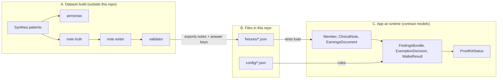
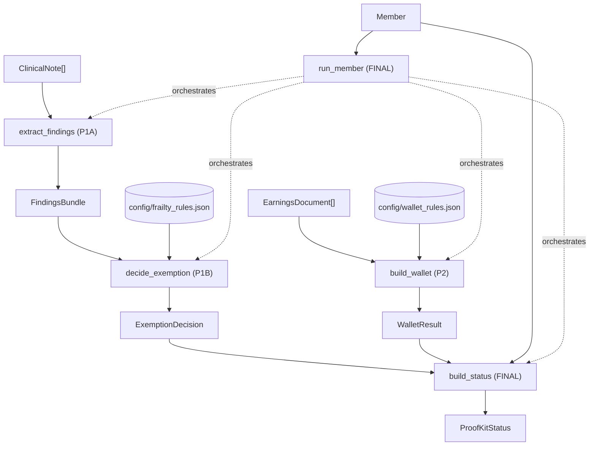
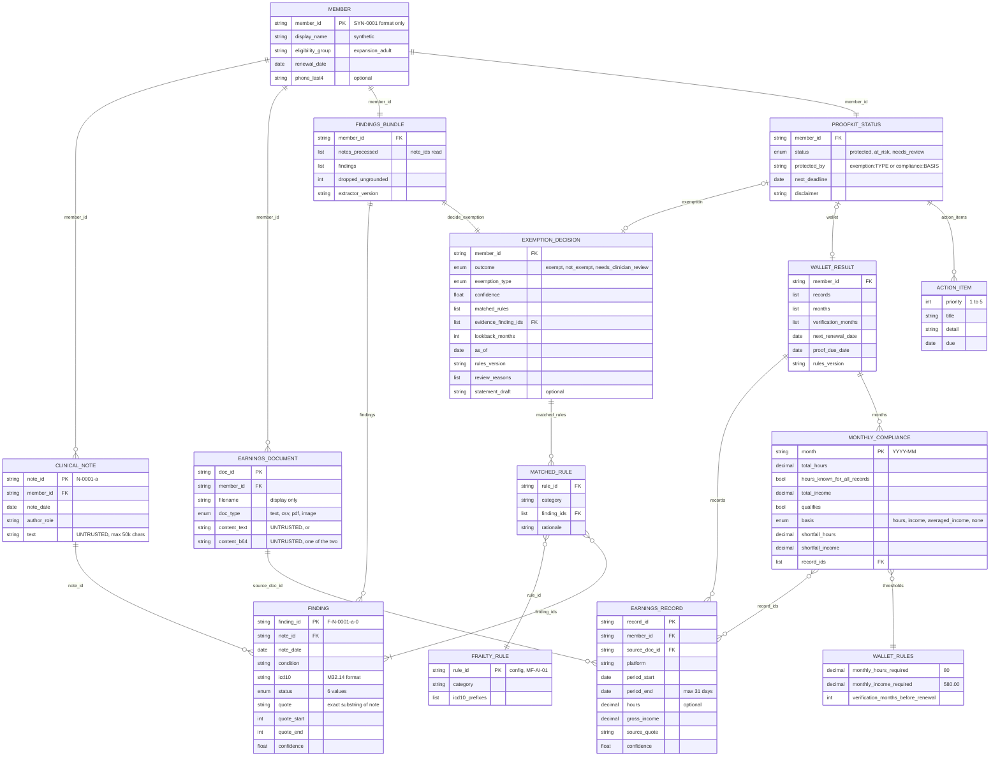
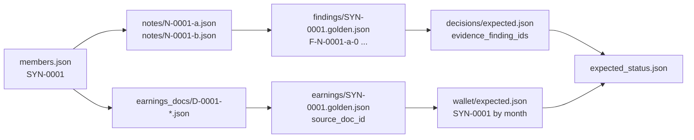
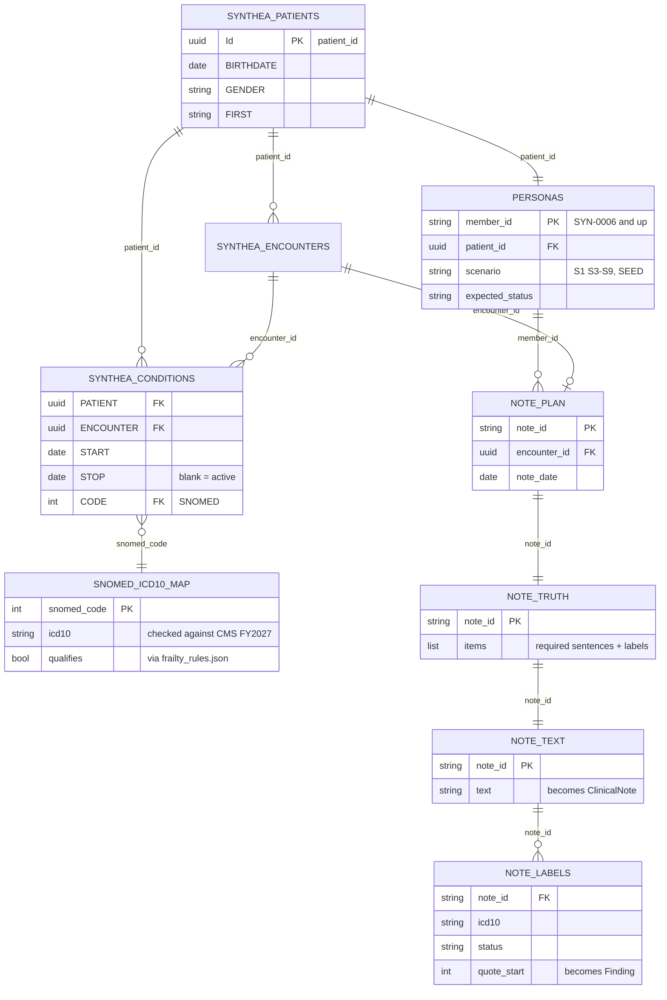

# ProofKit data schema

One page that shows every data object in ProofKit, where it lives, who owns it, and how it connects.
The source of truth is `src/proofkit/contracts/models.py`. If this page and the code disagree, the code wins.

## 1. The big picture

There are three layers. Data only flows left to right.

- **A** makes synthetic test data. Nothing in A is imported by the app.
- **B** is what the app and the tests read: fixture files shaped exactly like the contract models, plus rule configs.
- **C** is the running app. Modules talk to each other only through the contract models.

## 2. Runtime flow (who calls what)

| Function | Owner | Takes | Returns |
|---|---|---|---|
| `extract_findings(notes, member_id, llm)` | P1A | `ClinicalNote[]` | `FindingsBundle` |
| `decide_exemption(bundle, member, rules, as_of)` | P1B | `FindingsBundle`, `Member`, `FrailtyRules`, date | `ExemptionDecision` (no LLM, deterministic) |
| `draft_statement(decision, bundle, member, llm)` | P1B | `ExemptionDecision`, `FindingsBundle` | `str` (goes into `statement_draft`) |
| `build_wallet(member, docs, llm, rules, today)` | P2 | `EarningsDocument[]` | `WalletResult` |
| `parse_documents` / `evaluate_months` / `compute_deadlines` | P2 | documents / records / member | `EarningsRecord[]` / `MonthlyCompliance[]` / deadlines |
| `build_status(member, exemption, wallet, today)` | FINAL | the two results | `ProofKitStatus` |
| `run_member(member, notes, docs, llm, ...)` | FINAL | everything | `ProofKitStatus` |

## 3. Contract models and how they connect

`PK` = primary key, `FK` = points to another object. All models are immutable and reject unknown fields.

### Keys at a glance

| Key | Format | Defined in | Used by |
|---|---|---|---|
| `member_id` | `SYN-0001` (regex `^SYN-\d{4}$`) | `Member` | every model that belongs to a person |
| `note_id` | `N-0001-a` (member number + letter) | `ClinicalNote` | `Finding.note_id`, `FindingsBundle.notes_processed` |
| `finding_id` | `F-{note_id}-{i}`, i in quote order | `Finding` | `MatchedRule.finding_ids`, `ExemptionDecision.evidence_finding_ids` |
| `rule_id` | `MF-AI-01` | `config/frailty_rules.json` | `MatchedRule.rule_id` |
| `doc_id` | `D-0001-dd-jan` | `EarningsDocument` | `EarningsRecord.source_doc_id` |
| `record_id` | free text | `EarningsRecord` | `MonthlyCompliance.record_ids` |
| `month` | `YYYY-MM` | `MonthlyCompliance` | `WalletResult.verification_months` |

### Value rules

- `Finding.status` is one of `current`, `historical`, `ruled_out`, `negated`, `family_history`, `uncertain`.
- `Finding.icd10` is uppercase with a dot (`M32.14`). Family and past history use the **condition's own code**; the status says whose it is or when. Mother's breast cancer = `C50.919` + `family_history`, not `Z80.3`.
- A named denied symptom is a finding: "Denies chest pain" = `R07.9` + `negated`.
- `quote` must equal `note.text[quote_start:quote_end]`.
- Money and hours are `Decimal`, written as strings in JSON (`"598.20"`). Dates are ISO (`2027-03-01`).
- Only `current` findings can count toward an exemption (`counted_statuses` in `frailty_rules.json`).

## 4. Files in this repo

| File | Shape | Owner | Read by |
|---|---|---|---|
| `fixtures/members/members.json` | `{demo_today, members: Member[]}` | unassigned | tests, app |
| `fixtures/members/expected_status.json` | `{member_id: {status, protected_by}}` | unassigned | integration tests |
| `fixtures/notes/{note_id}.json` | `ClinicalNote` | P1A | tests (`notes_by_member`) |
| `fixtures/findings/{member_id}.golden.json` | `FindingsBundle` (answer key) | P1A | P1A acceptance tests |
| `fixtures/decisions/expected.json` | `{as_of, lookback_months, expected: {member_id: {outcome, exemption_type, rule_ids, evidence_finding_ids}}}` | P1B | P1B acceptance tests |
| `fixtures/earnings_docs/{doc_id}.json` | `EarningsDocument` | P2 | tests (`earnings_docs_by_member`) |
| `fixtures/earnings/{member_id}.golden.json` | `EarningsRecord[]` (answer key) | P2 | P2 acceptance tests |
| `fixtures/wallet/expected.json` | `{member_id: {month: MonthlyCompliance subset}}` | P2 | P2 acceptance tests |
| `config/frailty_rules.json` | rule list, `lookback_months`, `counted_statuses` | P1B | `decide_exemption` |
| `config/wallet_rules.json` | thresholds, verification months, platforms | P2 | `build_wallet` |

How the fixture files point at each other for one member:

## 5. Dataset build (outside this repo)

The extra synthetic personas are built in a separate folder (`proofkit-data/`) and exported into the
fixture files above. Only the export touches this repo.

| Dataset table | Exported to repo as |
|---|---|
| `personas` + Synthea first name | `Member` rows in `fixtures/members/members.json` |
| `note_text` + `note_plan` | `fixtures/notes/{note_id}.json` (`ClinicalNote`) |
| `note_labels` | `fixtures/findings/{member_id}.golden.json` (`FindingsBundle`) |

`patient_id` (Synthea) never enters the repo. Inside the app a person is only ever a `member_id`.

Status: the 5 seed members `SYN-0001`..`SYN-0005` are in the repo now. Generated members `SYN-0006`
and up are being validated and are not exported yet.

## 6. Open decisions

- Impairment severity (mild vs severe) has no field in `Finding`. Out of scope for this hackathon.
- Gig platform names: real names in the fixtures vs invented names in the dataset spec (P2 to decide).
- `fixtures/members/` has no owner in `CLAUDE.md`.
- `MF-DD-01` lists F70-F73 but not F79 (unspecified intellectual disability) (P1B to decide).
